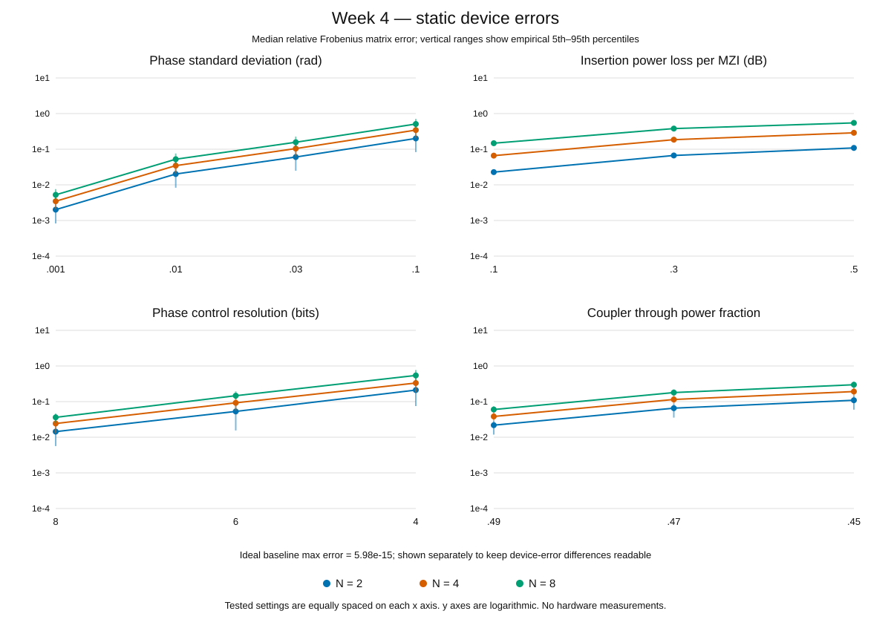

# 第四阶段 非理想光路

日期：2026-11-09。状态：**Python 模型、测试、示例和完整扫描已完成**。本周按要求先完成代码；Lumerical 留到后续，不在本目录声称其已运行。

## 本周完成内容

1. 保留原来的 MZI、Clements 和 SVD 数学标准。
2. 增加相位控制量的静态误差、插入损耗、上臂不平衡损耗、有限位数量化、耦合器偏差。
3. 固定一台器件后复用不同输入，避免重新随机导致伪造线性系统。
4. 独立推导两通道损耗和物理相位映射，加入解析测试；零误差恢复、完整复相位、功率被动性、输入不变和种子复现均已覆盖。
5. 生成一组可逐项阅读的 4×4 示例，以及 2、4、8 通道的配对批量扫描。

详细推导、模型范围、参数及调用方法见[非理想模型说明](../../docs/nonidealities.md)。开始让 AI 改代码前，仍然提供[统一标准](../../docs/technical-standards.md)。

## 如何运行

在 PyCharm 打开根目录的 `demo_week04.py`，点击 Run。默认示例把相位标准差设为 0.01 rad、每 MZI 插入损耗 0.1 dB、相位控制 8 bit、耦合器直通功率比 0.49。

```sh
python demo_week04.py
python verify_week04.py
python -m pytest -q
```

零误差对照：`python demo_week04.py --phase-std 0 --loss-db 0 --bits 0 --coupler 0.5 --output scratch_week04/ideal.json`。

默认 4×4 示例中，理想输出相对误差约 **9.16×10⁻¹⁶**，组合非理想输出相对误差约 **0.09517（9.517%）**。这是该输入和该固定器件的向量相对误差，不是分类错误率，也不代表器件总体性能。

## 实验规模和可复现性

- Python 3.12.4、NumPy 2.4.1；扫描 seed=20261109。
- N=2、4、8，各 20 个独立随机目标，实数/复数交替；每个矩阵每个条件 30 次静态器件实现。
- 每台器件输入 N 个基向量和 2 个随机复向量；所有条件共享目标、输入和器件 seed。
- 16 个条件，共 28,800 个条件内器件配置、192,000 组输入。无误差基线的不同 seed 对应等价器件。
- 另有 21 个结构化理想目标，覆盖零、秩亏、符号、增益和病态矩阵，采用与第三阶段一致的近零输出判据。

完整扫描的零误差回归与被动性检查均通过；本次完整测试套件 **152 项通过**（前三阶段 96 项，本周新增 56 项）。零误差扫描最大矩阵相对误差约 5.98e-15。分位范围为经验范围，不是置信区间；随机扫描没有对应真实芯片制造分布的主张。

## 主要结果

下表为**矩阵重建相对误差的中位数**；每格汇总 20 个目标矩阵×30 次器件实现。对比的是完整复数矩阵，不做全局相位对齐。

| 设置 | N=2 | N=4 | N=8 |
|---|---:|---:|---:|
| 理想基线 | 8.326e-16 | 2.151e-15 | 4.684e-15 |
| 相位误差 σ=0.01 rad | 2.014e-2 | 3.466e-2 | 5.243e-2 |
| 插入损耗 0.1 dB/MZI | 2.276e-2 | 6.605e-2 | 1.474e-1 |
| 4-bit 相位控制 | 2.110e-1 | 3.327e-1 | 5.435e-1 |
| 8-bit 相位控制 | 1.439e-2 | 2.431e-2 | 3.620e-2 |
| 直通功率比 0.49 | 2.181e-2 | 3.833e-2 | 6.000e-2 |
| 组合设置 | 3.938e-2 | 8.680e-2 | 1.679e-1 |

组合设置为 σ=0.01 rad、0.1 dB/MZI、8 bit、直通比 0.49。此次样本中，通道更多时对误差更敏感；提高控制位数降低了量化误差。该结论仅针对当前拓扑、参数和样本，不能保证每个输入的误差单调变化。



曲线纵轴为对数，点为中位数，竖线为经验 5%–95% 分位范围。横轴按已测试的离散设置等间隔排列。理想基线的最大误差单独注明，避免 10⁻¹⁵ 量级的基线压缩非理想结果之间的差别。

## 文件与验收解释

| 文件 | 内容 |
|---|---|
| [example_4x4.json](example_4x4.json) | W、x、NumPy 答案、理想配置、固定器件快照、全部中间场与原始功率 |
| [results.json](results.json) | 完整设定、样本数、误差分位、功率、理想回归、最差案例索引和 seed |
| [summary.csv](summary.csv) | 48 行按尺寸/条件汇总的结果，方便组员作图 |
| [sensitivity.svg](sensitivity.svg) | 来自同一批 JSON 数据的四组曲线 |

`results.json` 的顶层 `passed=true` 表示理想恢复和被动性都通过；并不意味着有损、带噪声输出仍等于理想结果。`fraction_exceeding_ideal_vector_tolerance` 记录超过 1e−10 理想阈值的比例，非理想条件下常为 1，不能称为代码失败率。

## 后续内容

继续做单独校准集上的增益/相位标定、AI 数字基线和光学线性层对照。动态噪声、真实读出和 Lumerical 仍待实现；本周没有生成或验证 Lumerical 工程文件。
