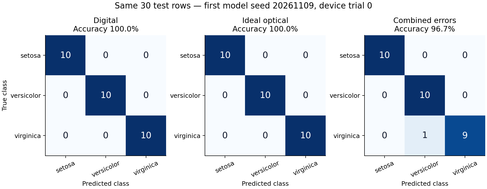
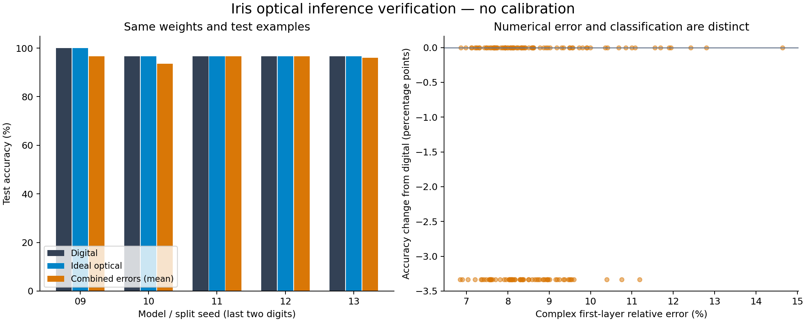
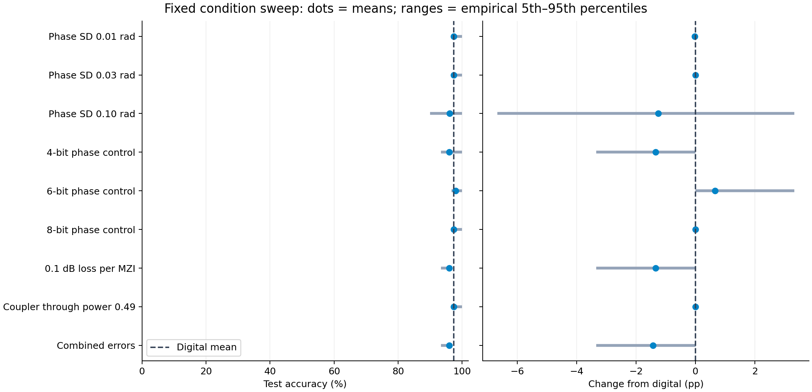
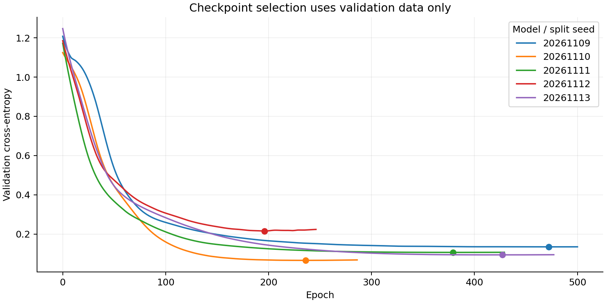

# 第五阶段 AI 推理验证

状态：Python 部分完成，2026-11-09。此次不包含校准或 Lumerical。

## 先看效果

在 PyCharm 打开项目根目录下的 `demo_week05.py` 并运行。它直接读取保存的首个模型，比较同样的 30 个测试样本，不用重新训练，也不需要联网。数字模型为 30/30，理想光路为 30/30，预设首台组合误差器件为 29/30。该演示使用事先固定的第一个 seed，并未按准确率挑选。



图中行是真实类别、列是预测类别；右图的一次错分为 virginica → versicolor。

## 完整实验结果

五次训练使用 20261109–20261113 五个固定种子。每次按类别划分 90 个训练、30 个验证、30 个测试样本；标准化只用训练集，权重选择只看验证损失。网络为 4→4→3，只有第一层 4×4 权重乘法由光路执行，偏置、ReLU 和最终分类头保持数字计算。

| 计算方式 | 平均测试准确率 | 与数字模型的平均差 |
|---|---:|---:|
| 数字模型 | 97.33% | — |
| 理想光路 | 97.33% | 0.00 个百分点 |
| 组合误差光路 | 95.91% | −1.42 个百分点 |

组合误差为相位标准差 0.01 rad、每个 MZI 插入损耗 0.1 dB、8-bit 相位控制、耦合器直通功率比 0.49。组合结果按 5 个模型、每模型 30 个固定器件取均值；同一模型各版本使用相同权重和测试输入。



| 单独或组合条件 | 平均准确率 | 相对数字平均变化（百分点） |
|---|---:|---:|
| 相位标准差 0.01 rad | 97.31% | −0.02 |
| 相位标准差 0.03 rad | 97.33% | 0.00 |
| 相位标准差 0.10 rad | 96.09% | −1.24 |
| 4-bit 相位控制 | 96.00% | −1.33 |
| 6-bit 相位控制 | 98.00% | +0.67 |
| 8-bit 相位控制 | 97.33% | 0.00 |
| 0.1 dB/MZI 插入损耗 | 96.00% | −1.33 |
| 耦合器直通功率比 0.49 | 97.33% | 0.00 |
| 组合误差 | 95.91% | −1.42 |

误差可能不改变分类，也可能偶然纠正某次错分。6-bit 的小幅提高不能推出低精度优于高精度，也不能据此选择参数后再把同一测试集称为未见数据。相位误差增大时，这个小样本任务的平均准确率不必严格单调下降。



点为均值，线段为经验 5%–95% 分位范围，不是置信区间。纯量化、损耗和耦合器条件没有随机相位偏差，同一模型的 30 个 seed 产生相同输出，不能视为独立器件测量。

## 验证证据与解释

- 新增 18 项针对 AI 的测试；全项目 170 项测试通过。
- 5 个模型的理想光路与数字模型在全部测试样本上预测一致。
- 理想第一层完整复输出的最大批量相对误差约 5.76×10⁻¹⁶；最大 logits 绝对误差约 1.87×10⁻¹⁴。
- 9 组非理想条件 × 5 个模型 × 30 个器件 seed，共 1,350 个条件内配置、40,500 次非理想预测；全部原始光路被动性检查通过。
- 首个示例的组合误差第一层复输出相对误差约 8.08%，分类准确率为 96.67%。数值误差百分比与分类错误率不是同一指标。
- 每个测试集仅 30 行，一次错分对应约 3.33 个百分点；不同划分之间会重用 Iris 样本。本实验验证小型任务的可行性，不代表普遍 AI 性能或硬件性能。



图中的点为各次训练选定的 epoch。测试数据没有参与训练、早停或模型选择。实验保留了所有预设 seed 的结果。

## 文件与重跑

| 文件 | 内容 |
|---|---|
| results.json | 数据哈希、训练方案、环境、每组汇总和验收结果 |
| devices.csv | 每台条件内器件的 seed、指标、混淆矩阵和全部 30 个预测 |
| models/seed_*.json | 数据划分、标准化参数、权重、训练历史和理想光路参数 |
| example.json | 首个模型、首台组合误差器件的完整光路快照、输入、复光场与预测 |
| accuracy、robustness、confusion、training 的 PNG/SVG | 同批结果的独立图表 |

从项目根目录运行：

```sh
python demo_week05.py
python -m pip install -r requirements-ai.txt
python verify_week05.py
python -m pytest -q
```

`demo_week05.py` 可只用原有 NumPy 环境运行。重新训练使用 CPU PyTorch 2.9.1；绘图使用 Matplotlib 3.10.7。固定 seed 和版本有助复现，但不同平台训练不保证逐位相同；可以读取本目录的 JSON 权重，对同一模型进行独立推理验证。

完整方案：[AI 验证说明](../../docs/ai-validation.md)。数据归属：[UCI Iris 及许可证](../../data/iris/README.md)。实际接收器、Lumerical、校准和通用张量接口仍未实现。
