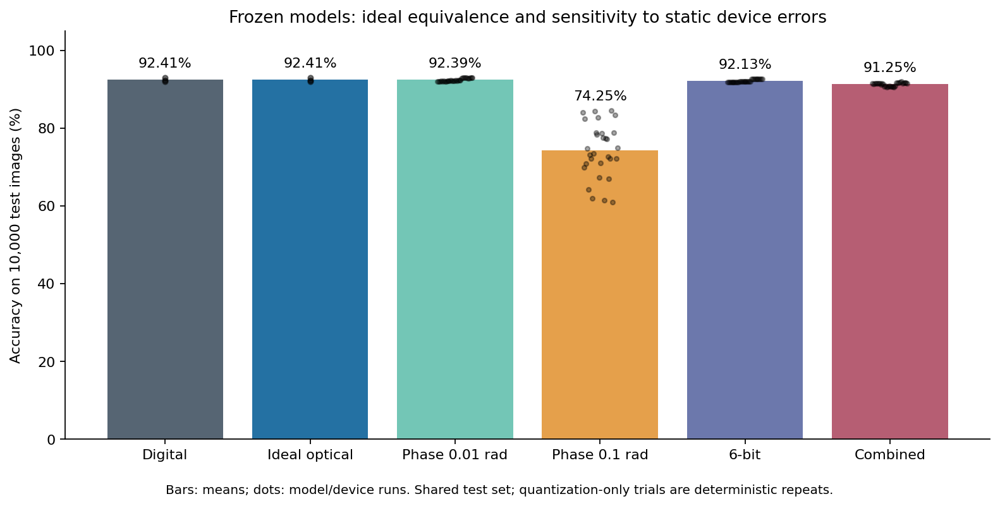
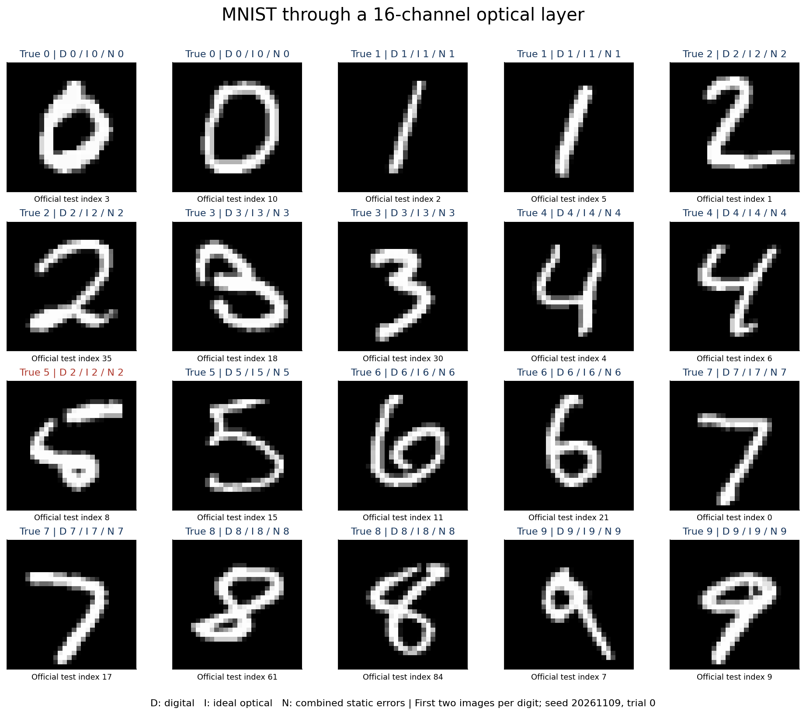
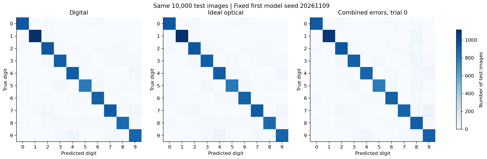
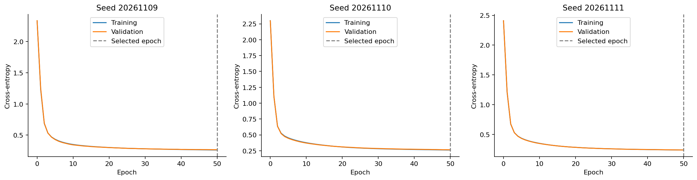

# 第六阶段：MNIST 手写数字识别

本阶段是 Iris 花卉识别之后的升级研究；[第五阶段](../05_ai_extension/README.md) 的代码、模型和结果完整保留。

**已完成 Python 端训练与光路验证。** 在同一个官方 10,000 张测试集上，三个冻结模型的数字与理想光路预测全部一致，平均准确率均为 **92.41%**；组合器件误差下平均为 **91.25%**，下降约 **1.16 个百分点**。

## 做了什么

1. 下载并校验真正的 MNIST（28×28 灰度、0–9 十类），划分 50,000 训练 / 10,000 验证 / 10,000 官方测试图片。
2. 只用训练集拟合 PCA，将 784 个像素压缩到 16 个实数特征；保留约 59.45% 的训练集像素方差。
3. 训练三个固定种子的 16→16→10 小型网络。第一层 16×16 权重通过 SVD 自动编译为两套 Clements 网格，共 240 个 MZI。
4. 冻结权重后逐 MZI 传播，比较数字推理、理想光路和四组静态器件误差；没有校准或带噪重训练。
5. 保存完整模型、PCA、划分、120 个非理想配置的指标及逐样本预测，共 1,200,000 次非理想预测。

图像降维、数字恢复比例、偏置、ReLU 和十分类输出头在数字端完成。这里只把第一层权重乘法换成光学传输矩阵仿真，并假设具有共同相位参考的相干场读出；尚未运行 Lumerical 或实际光器件。

## 全测试集结果

| 条件 | 平均准确率 | 相对数字基线 |
|---|---:|---:|
| 数字模型 | 92.41% | — |
| 理想光路 | 92.41% | 0.00 个百分点 |
| 静态相位误差 0.01 rad | 92.39% | −0.02 个百分点 |
| 静态相位误差 0.1 rad | 74.25% | −18.16 个百分点 |
| 6 bit 相位量化 | 92.13% | −0.28 个百分点 |
| 组合误差 | 91.25% | −1.16 个百分点 |

组合条件：相位标准差 0.01 rad、每 MZI 功率损耗 0.1 dB、8 bit 相位量化、耦合器 through=0.49。每个模型/条件取 10 个固定器件 seed，静态器件处理整个测试集；纯量化的 10 次是确定性重复。平均值不是独立数据集的总体置信区间，不能按单次偶然升降推断误差能提高性能。

| 模型种子 | 数字 / 理想准确率 | 组合误差平均准确率 | 验证集所选 epoch |
|---|---:|---:|---:|
| 20261109 | 91.99% | 91.42% | 50 |
| 20261110 | 92.31% | 90.69% | 50 |
| 20261111 | 92.93% | 91.64% | 50 |

三个模型均达到预设 50 epoch 上限，没有触发提前停止。这里是固定规模的小网络基线，未宣称已收敛到最优或达到 MNIST 领先精度。没有根据测试集重新选择训练设置。

理想光路对数字第一层的最大整体相对误差为 2.68×10⁻¹⁵；PyTorch 权重导出后的最大输出差为 1.60×10⁻¹⁴。矩阵重建、理想/零误差恢复、预测一致性、批量与逐样本传播、被动性检查全部通过。代码全套 **188 项测试通过**，包括原有 Iris 回归测试。



## 直接演示

在项目根目录运行 `python demo_week06.py`，或者在 PyCharm 打开该文件后点击 Run。使用保存的模型与 20 张示例图片，只需要 NumPy，无需联网、重新训练或安装 PyTorch。

展示图片固定选取官方测试集中每类最先出现的两张，使用第一个模型种子和组合误差 trial=0，未按预测正确性筛选。图中 D=数字、I=理想光路、N=组合误差；20 张图仅作演示，不替代 10,000 张全测试集的准确率。例如测试索引 8 的真实数字 5 在三条路径中都预测为 2，说明数字模型本身也会犯错，不能把所有错分归因于光路误差。



## 文件与复现

| 文件 | 内容 |
|---|---|
| results.json | 实验协议、环境、检查、各模型与条件汇总 |
| devices.csv | 每个非理想配置的准确率、混淆矩阵、误差指标与器件 seed |
| predictions.npz | 所有测试标签、索引及数字/理想/非理想逐样本预测；通过 CSV 的 prediction_key 对应 |
| models/seed_*.json | 冻结权重、训练历史、验证选择及理想光路参数 |
| preprocessor.npz | 仅训练集拟合的 PCA 均值、主成分、方差比例 |
| split_indices.npz | 官方训练数据中的训练/验证索引 |
| demo_samples.npz、example.json | 20 张固定示例图片及逐步复场、输出和预测 |
| data_provenance.json | 数据来源及文件校验值 |
| accuracy.png、confusion.png、training.png、examples.png | 可用于汇报的图表 |

在项目根目录完整重跑：

```sh
python -m pip install -r requirements-ai.txt
python verify_week06.py --download
python demo_week06.py
python -m pytest -q
```

开发检查请加 `--output-dir scratch_mnist`，避免覆盖正式记录。所有实验约定见 [MNIST 验证协议](../../docs/mnist-validation.md)，全组统一数学规则见 [技术标准](../../docs/technical-standards.md)。




