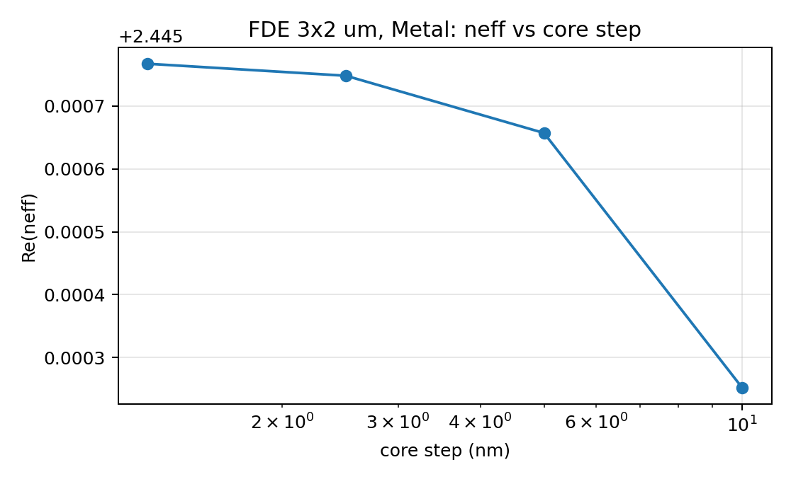
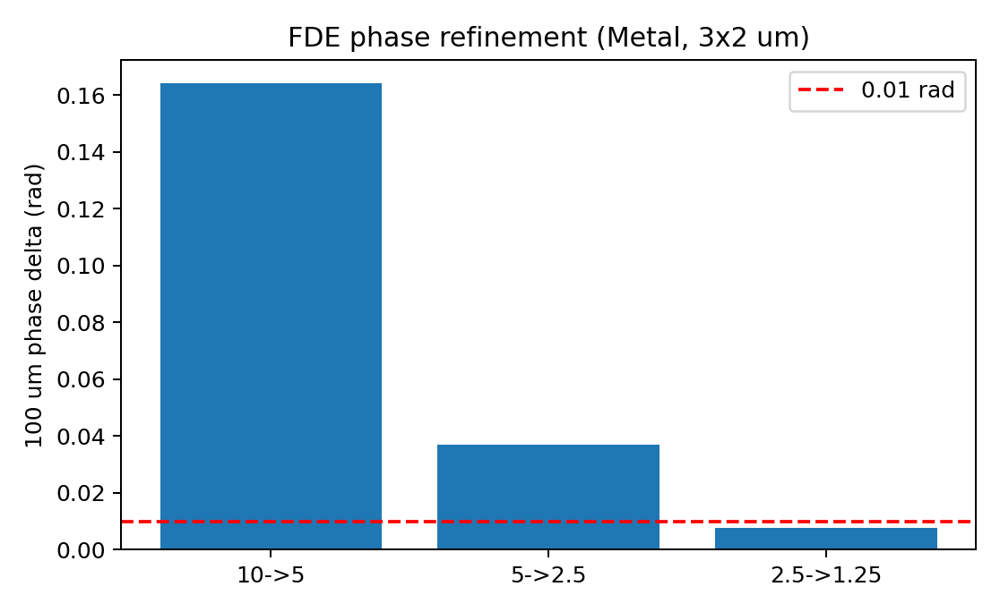

# 第四轮：均匀直波导 FDE 与 EME 复核

日期：2026-11-12  
状态：**FDE 网格相位未通过；域/边界数值稳定；EME 长度相位与 FDE 不一致。整体 `complete=false`。**

## 1. 本轮改了什么

- `lumerical/validation.py`
  - 新增 `phase_and_loss_changes()`：相位只用 `Re(neff)` 差，`Im(neff)` 差单独折算为损耗 dB。
  - `fde_phase_metrics()` 保留原字段并改为实部语义。
- `lumerical/run_device_fde_local.py`
  - 显式 Metal/PML 四侧边界、PML 层数。
  - 外围最大步长 50 nm，核心局部网格 1.2×0.8 µm。
  - 不再默认读取 `mode1`：首档枚举模式，按 TE fraction + 导模 neff 选择；后续用 `bestoverlap()` / `overlap()` 跟踪。
  - 保存实际 y/z 网格、`index_x`、目标模式 E/H、复 neff、TE fraction、重叠。
  - 终止判据为最近两个连续细化区间；历史粗档保留。
- `lumerical/run_device_eme_minimal.py`
  - 增加 `--length-um`、`--length-scan`、`--domain-um`、`--cell-modes`、`--boundary`、`--pml-layers`、`--core-step-nm`。
  - 保存完整复 S、最大振幅、最大奇异值、`S†S-I` 残差；严格被动性单独报告。
  - 用 10/10.1/10.2 µm 的长度差反推 `beta/neff`。

## 2. FDE 网格系列（3×2 µm，Metal）

| 核心步长 nm | Re(neff) | 与上一档重叠 |
|---:|---:|---:|
| 10 | 2.4452520854 | — |
| 5 | 2.4456570442 | 0.999408 |
| 2.5 | 2.4457480915 | 0.999851 |
| 1.25 | 2.4457671489 | 0.999962 |

100 µm 相位差：

```text
10 → 5 nm:    0.16416 rad   fail
5 → 2.5 nm:   0.03691 rad   fail
2.5 → 1.25 nm: 0.00773 rad  pass
```

最近两个连续区间是 `5→2.5` 和 `2.5→1.25`，前者超 `0.01`，所以：

```text
mode_identity_valid = true
phase_mesh_converged = false
complete = false
```

`0.625 nm` 补充运行在约 **5.16 GB** 工作集、超过 10 分钟未完成，已终止；没有把未完成数据写入收敛结论。

模式重叠均 ≥ 0.9994，说明这几档跟踪到同一候选模式；但重叠通过不等于相位通过。





## 3. 域大小对照（2.5 nm，Metal）

| 域 y×z µm | Re(neff) |
|---|---:|
| 3×2 | 2.4457480915 |
| 4×3 | 2.4457483599 |
| 5×4 | 2.4457483600 |

100 µm 相位差：

```text
3×2 → 4×3: 1.09×10⁻⁴ rad
4×3 → 5×4: 3.17×10⁻⁸ rad
```

仅从这组 2.5 nm 数据看，域变化远低于 0.01 rad；但这是**单步长**的域对照，不是完整网格收敛，且单目录没有模式重叠。因此：

```text
domain_converged = true（仅该数值对照）
complete = false
```

## 4. 边界对照（5×4 µm，2.5 nm）

| 边界 | Re(neff) | Im(neff) |
|---|---:|---:|
| Metal | 2.4457483600 | 0 |
| PML 16 | 2.4457483600 | -4.04×10⁻¹⁷ |
| PML 24 | 2.4457483600 | -3.13×10⁻¹⁷ |

100 µm 相位差约 `6×10⁻¹²`、`8×10⁻¹² rad`。PML 的微小负虚部被保留并报告为疑似数值增益，没有取绝对值或置零伪装无损。

边界数值稳定，但 `complete` 仍为 false，因为网格系列最后两个区间没有都通过。

## 5. EME 长度相位检查

2×2 候选 S（10 µm）：

```text
S21 = -0.19668884 - 0.98046596i
max|S| = 1.0000000000000189
max singular value = 1.0000000000000189
strict_raw_passive = false
```

长度 10/10.1/10.2 µm 均得到非零 2×2 S，由相邻 S21 相位差反推：

```text
neff_from_length = 2.436366
FDE neff(2.5 nm) = 2.445748
100 µm 相位差 = 3.803 rad
```

因此 EME 长度相位**不与 FDE 一致**；不能把 EME 的非零 S 当作器件验证通过。长度反推的符号/端口相位参考仍需检查。

严格被动性：原始 `max|S|` 和最大奇异值都约 `1.0000000000000189 > 1`，所以 `strict_raw_passive=false`；`candidate_lossless=true` 只是代数残差描述，不能替代严格判据。

## 6. 结论

```text
FDE 模式跟踪：通过（重叠 ≥ 0.9994）
FDE 网格相位：未通过（5→2.5 为 0.0369 rad；0.625 nm 未完成）
FDE 域大小：数值稳定（单 2.5 nm 对照）
FDE 边界：数值稳定（Metal/PML16/PML24）
EME 非零 2×2：通过“流程”检查
EME 严格被动性：未通过（max|S|/max SV > 1）
EME 长度相位 vs FDE：不一致（3.803 rad）
整体 complete：false
```

## 7. 运行命令

```powershell
$py = "D:\Program Files\ANSYS Inc\v252\Lumerical\python-3.13.1\python.exe"

# FDE 主网格系列（含 1.25 nm）
& $py lumerical\run_device_fde_local.py --steps-nm 10 5 2.5 1.25 ^
  --domain-um 3 2 --boundary metal --trial-modes 10 --export-fields ^
  --out progress\07_lumerical\round4\fde_mesh_1p25

# 域对照
& $py lumerical\run_device_fde_local.py --steps-nm 2.5 --domain-um 4 3 ^
  --boundary metal --trial-modes 10 --out progress\07_lumerical\round4\fde_domain_4x3
& $py lumerical\run_device_fde_local.py --steps-nm 2.5 --domain-um 5 4 ^
  --boundary metal --trial-modes 10 --out progress\07_lumerical\round4\fde_domain_5x4

# 边界对照
& $py lumerical\run_device_fde_local.py --steps-nm 2.5 --domain-um 5 4 ^
  --boundary pml --pml-layers 16 --trial-modes 10 --out progress\07_lumerical\round4\fde_pml16
& $py lumerical\run_device_fde_local.py --steps-nm 2.5 --domain-um 5 4 ^
  --boundary pml --pml-layers 24 --trial-modes 10 --out progress\07_lumerical\round4\fde_pml24

# EME 长度扫描
& $py lumerical\run_device_eme_minimal.py --run --length-scan --length-um 10 ^
  --domain-um 4 3 --cell-modes 5 --boundary pml --pml-layers 16 ^
  --out progress\07_lumerical\round4\eme_length_scan
```

## 8. 文件

```text
lumerical/run_device_fde_local.py
lumerical/run_device_eme_minimal.py
lumerical/validation.py

progress/07_lumerical/round4/summary.json
progress/07_lumerical/round4/fde_mesh_1p25/
progress/07_lumerical/round4/fde_domain_4x3/
progress/07_lumerical/round4/fde_domain_5x4/
progress/07_lumerical/round4/fde_pml16/
progress/07_lumerical/round4/fde_pml24/
progress/07_lumerical/round4/eme_length_scan/
```

适用范围：均匀 500×220 nm Si 条波导、SiO₂ 全包层；不是完整晶圆截面，不是耦合器/MZI 的非均匀结构验证。
